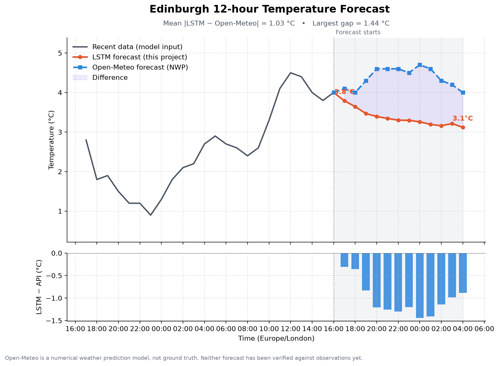
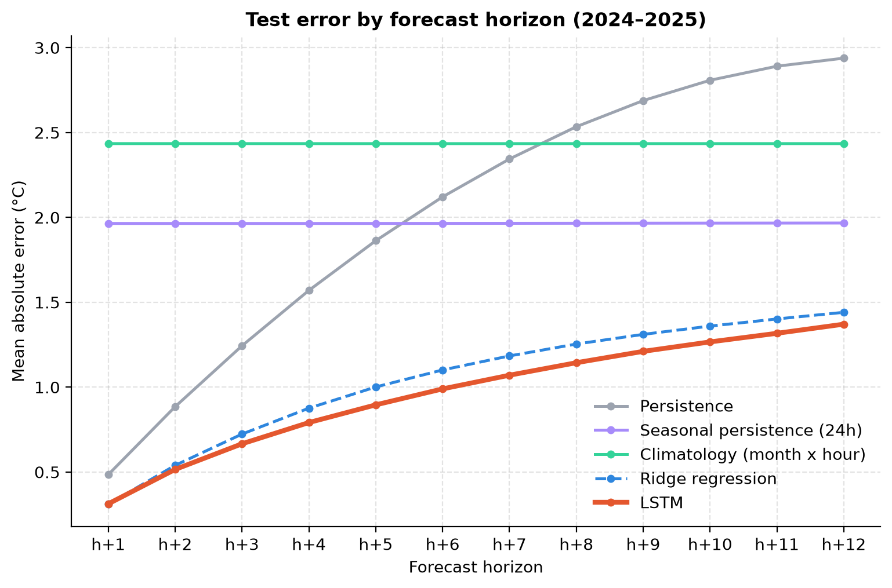
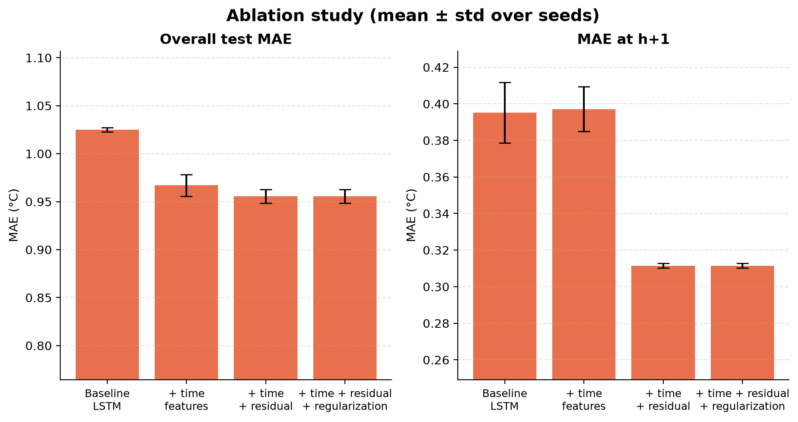

# Edinburgh 12-Hour Temperature Forecasting with LSTM

A PyTorch LSTM that reads the previous 72 hours of weather in Edinburgh, Scotland and forecasts the air temperature for the next 12 hours. The project is evaluated against several baselines, validated with an ablation study over multiple random seeds, and compared live against the numerical weather prediction (NWP) forecast from Open-Meteo.



*Example live run: recent data (grey), this project's LSTM forecast (orange) and the Open-Meteo NWP forecast (blue). Neither forecast was verified against observations at plotting time; every run is appended to `outputs/forecast_log.csv` so it can be verified later.*

## Key results

Evaluated on two full, unseen years (2024–2025, 17,533 test windows, all four seasons):

| Model | MAE (°C) | RMSE (°C) |
|---|---:|---:|
| Climatology (month × hour) | 2.435 | 3.094 |
| Persistence (last value) | 2.031 | 2.785 |
| Seasonal persistence (24 h ago) | 1.965 | 2.602 |
| Ridge regression (same inputs) | 1.042 | 1.443 |
| **LSTM** (mean ± std, 5 seeds) | **0.956 ± 0.007** | **1.321 ± 0.010** |

- The LSTM reduces MAE by about **53 %** versus persistence, but only about **8 %** versus a tuned linear model (Ridge) given the same inputs. The Ridge comparison is the fairer measure of what the neural network adds.
- The advantage over Ridge grows with the forecast horizon (see below).

## Data

- **Source:** ERA5 reanalysis via the [Open-Meteo Archive API](https://open-meteo.com/en/docs/historical-weather-api).
- **Location:** Edinburgh (55.9533° N, 3.1883° W), hourly.
- **Period:** 2015-01-01 to 2025-12-31 (96,432 hourly records, fixed dates for reproducibility).
- **Variables:** temperature at 2 m, relative humidity, precipitation, wind speed at 10 m, surface pressure, cloud cover.
- **Quality checks:** no missing values, no duplicate timestamps, strictly hourly spacing (enforced in code).

## Method

**Split by calendar year (chronological):** training 2015–2022, validation 2023, test 2024–2025. The standard scaler is fitted on training data only. Input windows of the validation/test sets may look back into the previous split (as in real use), but all forecast targets lie strictly inside their own split.

**Task:** direct multi-step forecasting. Input `(72, F)`, output 12 temperatures at once (not recursive).

**Model:** 2-layer LSTM, 64 hidden units, dropout 0.2, linear head. Adam-family optimizer, MSE loss, early stopping (patience 10) on validation loss.

**Improvements over the plain LSTM** (evaluated individually in the ablation below):

1. **Cyclical time features:** `sin/cos` of hour-of-day and day-of-year, so the network knows the time of day and season.
2. **Residual output:** the network predicts the *change* relative to the last observed temperature (implemented as a skip connection), which makes short horizons much easier.
3. **Regularization:** AdamW weight decay, ReduceLROnPlateau and gradient clipping (no measurable effect, see below).

**Baselines:** persistence, seasonal persistence (value 24 h earlier), climatology (training mean per month and hour), and Ridge regression on the flattened input window (receives the same features as the LSTM).

## Results

### Error by forecast horizon



Single run (seed 42), MAE in °C:

| Horizon | Persistence | Ridge | LSTM |
|---|---:|---:|---:|
| h+1 | 0.485 | 0.310 | 0.313 |
| h+3 | 1.244 | 0.724 | 0.666 |
| h+6 | 2.121 | 1.101 | 0.990 |
| h+12 | 2.938 | 1.441 | 1.371 |

For the first hour the LSTM and Ridge are equivalent; the LSTM becomes clearly better from about h+3 onward.

### Ablation study



Test MAE in °C, mean ± std over 5 seeds (42, 1, 2, 3, 4):

| Configuration | MAE | h+1 MAE | h+12 MAE |
|---|---:|---:|---:|
| Baseline LSTM | 1.025 ± 0.002 | 0.395 ± 0.017 | 1.403 ± 0.008 |
| + time features | 0.967 ± 0.011 | 0.397 ± 0.012 | 1.343 ± 0.014 |
| + time features + residual output | **0.956 ± 0.007** | **0.312 ± 0.001** | 1.359 ± 0.014 |
| + time features + residual + regularization | 0.956 ± 0.007 | 0.312 ± 0.001 | 1.359 ± 0.014 |

Findings:

- **Time features are the largest contributor** to overall accuracy (≈ 5.7 % lower MAE), mainly at longer horizons.
- **The residual output mainly fixes the first hours:** h+1 MAE drops from 0.397 to 0.312 with very small seed variance. Its effect on overall MAE (0.967 → 0.956) is within about one standard deviation and should not be over-interpreted; h+12 is possibly slightly worse (also within noise).
- **Regularization had no measurable effect.** With early stopping the best epoch occurs very early, before the learning-rate scheduler acts, and the weight decay (1e-4) is weak. Results are identical to the un-regularized model, so the final model omits it.
- Residual output alone (1.032) and regularization alone (1.024) were run once with seed 42 only and are not distinguishable from the baseline.

**Final model:** time features + residual output (`time_residual`).

## Live forecast and comparison with Open-Meteo

`predict.py` downloads the latest 72 complete hours, forecasts the next 12 with the trained LSTM and plots them together with the forecast that Open-Meteo itself publishes for the same hours. The chart shows the recent history, both forecasts, the shaded difference and the hourly gap.

Open-Meteo's forecast is produced by NWP models that simulate the future state of the atmosphere, whereas the LSTM only sees the past 72 hours at one location. The comparison therefore shows how close a lightweight model gets to NWP, not whether it can replace it. Each run is appended to `outputs/forecast_log.csv` (timestamp, LSTM value, Open-Meteo value) so both can be scored against real observations later.

## Reproducing the results

```bash
pip install -r requirements.txt

python3 data.py          # download ERA5 data (~11 API calls)
python3 train.py         # train the final model (time_residual, seed 42)
python3 evaluate.py      # metrics for all models -> outputs/metrics_time_residual.json
python3 predict.py       # live forecast + comparison chart
```

Ablation and multiple seeds (experiments: `baseline`, `time`, `residual`, `regularized`, `time_residual`, `full`):

```bash
for e in baseline time residual regularized time_residual full; do
  EXPERIMENT=$e python3 train.py && EXPERIMENT=$e python3 evaluate.py
done

for s in 1 2 3 4; do for e in baseline time time_residual full; do
  SEED=$s EXPERIMENT=$e python3 train.py && SEED=$s EXPERIMENT=$e python3 evaluate.py
done; done

python3 compare_experiments.py   # single-seed comparison table
python3 aggregate_seeds.py       # mean ± std over seeds
python3 make_figures.py          # figures/error_by_horizon.png and figures/ablation.png
```

All settings (dates, split, features, hyperparameters, seed) live in `config.py`. Runs use fixed seeds; small numerical differences between devices (CPU / CUDA / Apple MPS) are possible.

## Project structure

```text
Edinburgh-Weather/
├── config.py               # all paths, dates, hyperparameters, experiments
├── data.py                 # ERA5 download, validation, windowing, split
├── features.py             # feature engineering (shared by training and prediction)
├── model.py                # LSTM with optional residual skip connection
├── baselines.py            # persistence, seasonal, climatology, Ridge
├── train.py                # training with early stopping
├── evaluate.py             # metrics for LSTM and all baselines
├── predict.py              # live forecast, Open-Meteo comparison, forecast log
├── compare_experiments.py  # ablation table (single seed)
├── aggregate_seeds.py      # mean ± std over seeds
├── make_figures.py         # README figures
├── utils.py                # seed, device, helpers
├── requirements.txt
├── dataset/                # downloaded data (git-ignored)
├── models/                 # trained weights and scalers (git-ignored)
├── outputs/                # metrics JSON files, training histories, forecast log
└── figures/                # images used in this README
```

## Limitations

- **Reanalysis, not station observations.** ERA5 is a model-assisted reconstruction on a coarse grid (tens of kilometres). The network learns ERA5 behaviour, which may differ from what a thermometer in Edinburgh reads.
- **Train/inference data mismatch.** The model is trained on ERA5 but the live input comes from the Open-Meteo forecast API (its recent hours are model analysis data). The distributions are similar but not identical, so live performance may differ from the test results.
- **Live forecasts are not yet verified.** The comparison with Open-Meteo is descriptive until enough entries in `forecast_log.csv` can be compared with observed temperatures.
- **Single location, single variable target.** Only Edinburgh and only temperature are forecast.
- **Test years are warmer than the training period** (the climatology baseline shows a −0.71 °C bias), which may slightly favour models that use the most recent observations.
- **No formal significance test.** Seed variation (n = 5) is reported, but differences of roughly one standard deviation (e.g. the residual output's effect on overall MAE) are not claimed as significant.
- **Early overfitting.** Validation loss reaches its minimum after only a few epochs; stronger regularization or architectural changes were not found to help in this study.

## Possible extensions

- Compare with GRU, temporal convolution and Transformer models.
- Probabilistic forecasts (quantile regression) with calibration analysis.
- Verify live forecasts against independent station observations (e.g. Met Office).
- Statistical testing (Diebold–Mariano or bootstrap confidence intervals) and walk-forward validation.
- Additional inputs such as wind direction components, dew point and radiation; multiple cities.